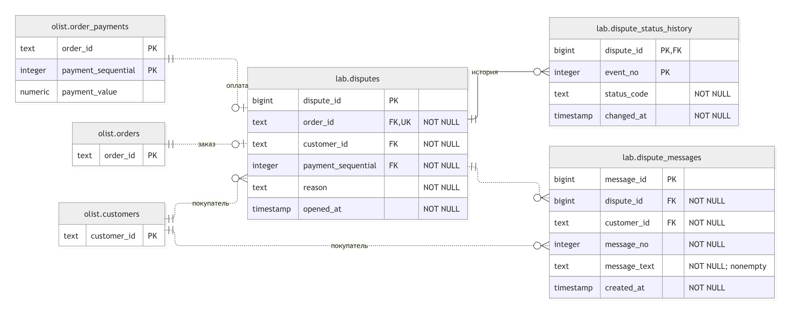

# Практическая работа №8

Карпов Андрей Сергеевич, ИНБО-20-23. Вариант 9 — споры по оплаченным заказам.

Спор хранится в `lab.disputes`, сообщения покупателя — в `lab.dispute_messages`, последовательность статусов — в `lab.dispute_status_history`. Текущий статус определяется последним событием, поэтому его копия в `disputes` не нужна. Сведения о заказах и платежах берутся из Olist.

| Бизнес-правило | Реализация |
|---|---|
| Каждый спор имеет уникальный идентификатор | `pk_disputes` |
| В принятой модели по заказу открывается не более одного спора | `uq_disputes_order` |
| При открытии спора существует положительный платёж по его заказу | `fk_disputes_order`, `fk_disputes_payment`, `trg_validate_dispute` |
| Заявитель является покупателем заказа; спор открыт после покупки | `fk_disputes_customer`, `trg_validate_dispute` |
| Причина спора и текст сообщения заполнены | `NOT NULL`, `ck_disputes_reason`, `ck_dispute_messages_text` |
| Сообщение принадлежит спору и его заявителю | составной `fk_dispute_messages_dispute`, `fk_dispute_messages_customer` |
| Номера сообщений положительны и уникальны внутри спора | `ck_dispute_messages_number`, `uq_dispute_messages_number` |
| Номера событий положительны и уникальны внутри спора | `ck_dispute_status_history_number`, `pk_dispute_status_history` |
| Статус принимает значения open, review, resolved | `ck_dispute_status_history_code` |

Платёжная связь подтверждает наличие платежа с положительной суммой в момент открытия, а не расчёт полной оплаты стоимости заказа. Проверка принадлежности покупателю и суммы платежа требует обращения к другой таблице и вынесена в триггер; остальные правила выражены декларативно.

Рисунок 1 — ER-диаграмма, построенная в diagrams.net. Две черты обозначают ровно одну запись, кружок — необязательное участие, «воронья лапка» — множество. PK — первичный ключ, FK — внешний ключ, UK — уникальный ключ; NOT NULL — обязательное поле. Составной первичный ключ включает оба поля с отметкой PK.

В каждую из трёх таблиц добавляются пять тестовых строк на реальных идентификаторах заказов и покупателей. Ошибочные запросы приведены в SQL как комментарии с именами отклоняющих ограничений. В конце выводятся ограничения из `information_schema` и `pg_catalog`.

Выполнение из корня проекта: `psql -X -v ON_ERROR_STOP=1 -d olist -f lab08/lab08.sql`. Схемы и данные Olist должны быть загружены по практике №1. DDL рассчитан на первоначальное выполнение в чистом учебном фрагменте схемы `lab`.
